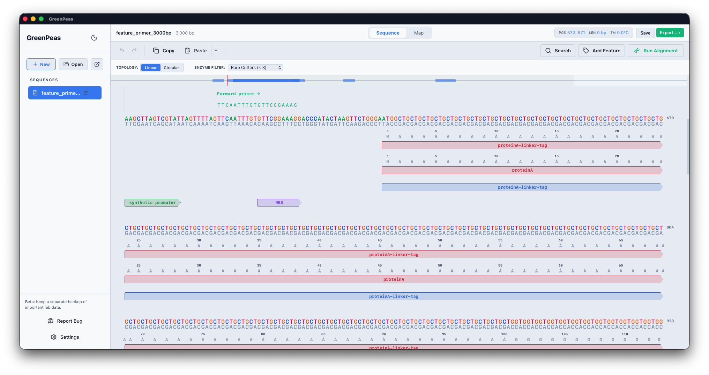
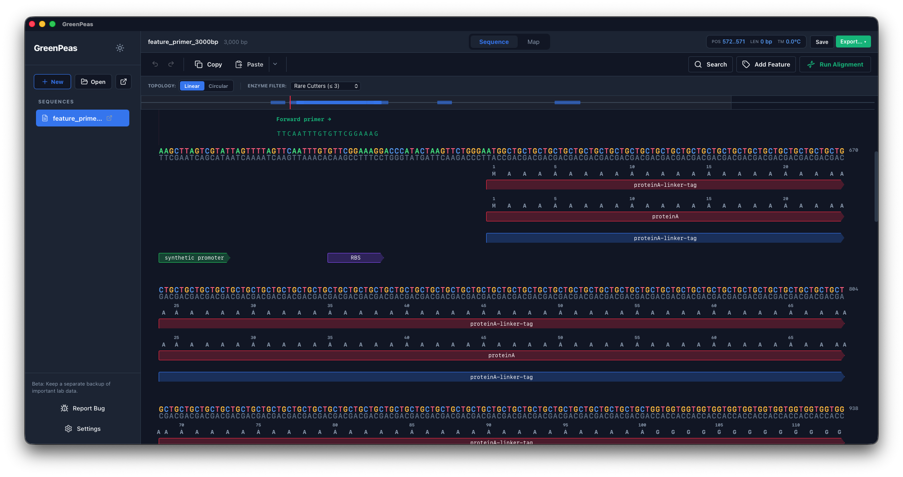
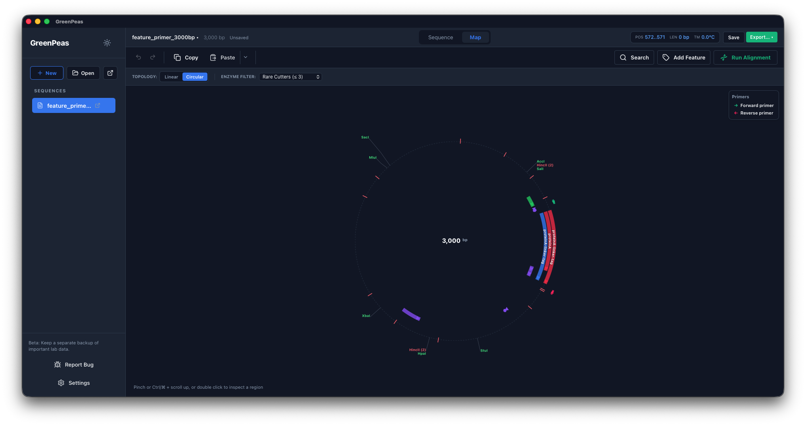
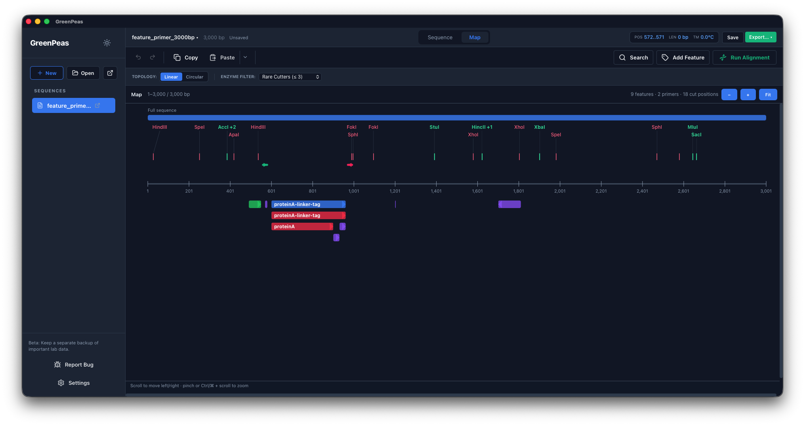
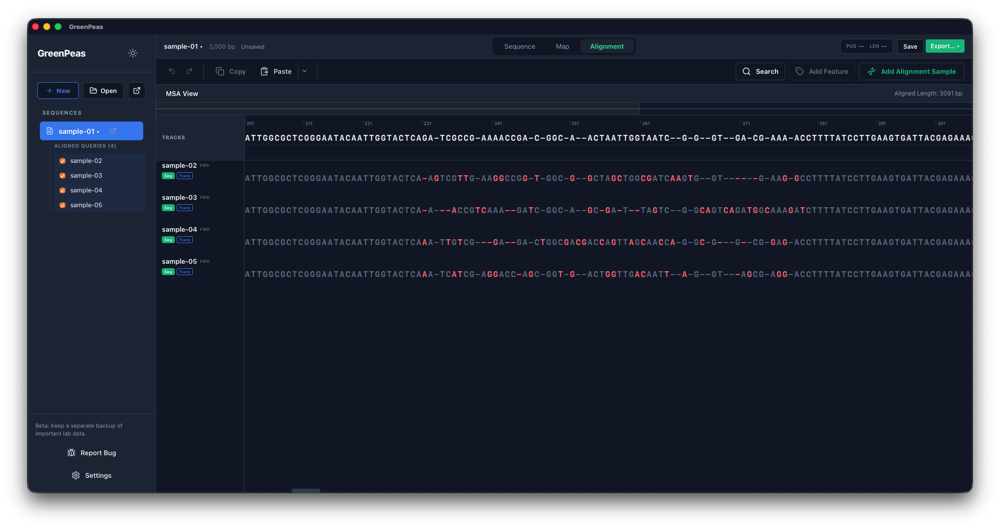
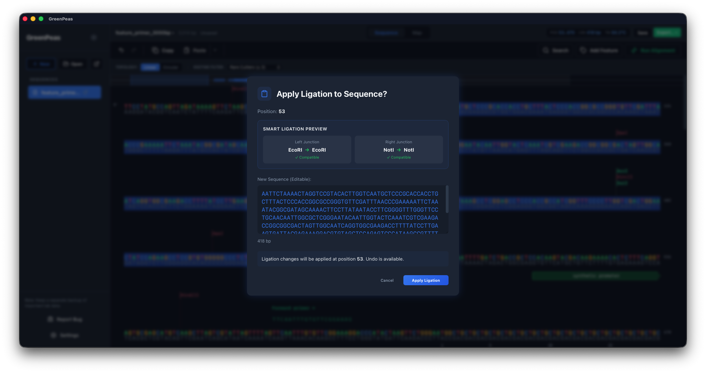

# GreenPeas

[日本語版 README](README_ja.md)

GreenPeas is a desktop DNA sequence editor and cloning workspace built with Tauri, Rust, React, and TypeScript.

GreenPeas is licensed under the MIT License. This repository contains the application source and documentation.

See [DEVELOPMENT.md](DEVELOPMENT.md) for the maintained architecture guide,
development rules, implemented milestones, and backlog.

## Screenshots

Click an image to view it at full size.

| Sequence view · light | Sequence view · dark |
| --- | --- |
| [](docs/screenshots/lightmode.png) | [](docs/screenshots/darkmode.png) |

| Circular map | Linear map |
| --- | --- |
| [](docs/screenshots/circlemap.png) | [](docs/screenshots/linearmap.png) |

**Sequence alignment · five samples**

[](docs/screenshots/alignment.png)

The synthetic sequences shown here are available in [test-data/alignment-samples](test-data/alignment-samples).

**Smart Ligation preview**

[](docs/screenshots/smart-ligation.png)

## 🧬 About the Name & Logo

GreenPeas takes its name from the pea plants Gregor Mendel used to uncover the basic patterns of inheritance. The logo combines a DNA double helix with motifs of the round (smooth) and wrinkled pea seeds he studied.

## Lightweight by Design

GreenPeas is designed to use memory sparingly and stay responsive during quick sequence viewing and everyday cloning workflows, including on laptops with limited resources. See [BENCHMARKS.md](BENCHMARKS.md) for reproducible Rust core benchmarks.

## Current Release Plan

- First publication: source code in [GreenPeas](https://github.com/ryuabiru/GreenPeas)
- Installable beta builds: to be compiled, validated, and distributed later
- Next release tag: to be assigned after the beta build is validated
- Development app version: `0.1.0`
- Project license: MIT License
- First beta binary: Apple Silicon Mac (`arm64`); the Windows `x64` build and launch have been validated locally and are planned for the next beta release; Intel Mac will follow validation

## What GreenPeas Does

- Opens and edits DNA sequence files, including GenBank and SnapGene-style workflows.
- Displays linear and map-oriented sequence views.
- Handles annotations, primers, restriction enzymes, and alignment-oriented workflows.
- Supports cloning-oriented operations such as fragment handling and Smart Ligation validation.
- Includes an in-app helper for drafting GitHub bug reports.

## Beta Expectations

The planned beta is intended for testing and feedback. Please avoid relying on it as the only copy of important lab data.

The next beta uses an ad-hoc macOS signature, without a Developer ID signature or notarization. The `release:macos` script builds only for the architecture of the build host; Intel (`x64`) and Apple Silicon (`arm64`) apps are separate artifacts, not a universal app. Download future beta builds only from the [official GreenPeas Releases page](https://github.com/ryuabiru/GreenPeas/releases).

macOS may block the app because it is not notarized. After downloading it from the official repository, try opening it once. If macOS blocks it, open **System Settings → Privacy & Security**, scroll to Security, choose **Open Anyway** for GreenPeas, then confirm **Open**. Only override this warning for a build obtained from the official repository and that you trust. See [Apple's instructions for safely opening apps](https://support.apple.com/102445).

Known priorities for future releases:

- More real-world file compatibility testing.
- More release-build validation on supported platforms.
- Intel Mac release builds and clean-machine launch checks.

## Development

Install dependencies inside this project only. Do not install project tooling globally.

```sh
npm install
npm run build
```

Run the Tauri app during development:

```sh
npm run tauri dev
```

Build a distributable app:

```sh
npm run release:macos
npm run release:windows # on Windows
```

Build each release on its target OS. The scripts regenerate `THIRD_PARTY_LICENSES.txt` for that machine before packaging. On October 27, 2026, the Windows `x64` release build, MSI and NSIS installer creation, and post-install launch were verified on a Windows machine. Launch on a separate machine without development tools remains unverified.

Run Rust checks from the Tauri package:

```sh
cd src-tauri
cargo check
```

Run the reproducible Rust core benchmarks:

```sh
npm run benchmark:core -- --quick
```

See [BENCHMARKS.md](BENCHMARKS.md) for full and real-file benchmark options.

## Reporting Issues

Use [GitHub Issues](https://github.com/ryuabiru/GreenPeas/issues) for bug reports and feature requests. Include:

- GreenPeas version and platform.
- The file type you were using, if relevant.
- Steps to reproduce.
- Expected behavior.
- Actual behavior.

The app's bug report dialog generates a privacy-reduced diagnostics block and opens a pre-filled GitHub Issue. Nothing is submitted automatically. Issues are public, so do not include DNA sequences, local file paths, personal information, or other sensitive data.

Do not report security vulnerabilities in a public issue. Follow the private reporting instructions in [SECURITY.md](SECURITY.md).

## License

GreenPeas is distributed under the [MIT License](LICENSE). You may use, copy, modify, and redistribute it under the terms of that license.

Third-party components remain governed by their own licenses. Their notices, license terms, and source locations are provided in [THIRD_PARTY_LICENSES.txt](THIRD_PARTY_LICENSES.txt). See [LICENSE_AUDIT.md](LICENSE_AUDIT.md) for the release-compliance review.
